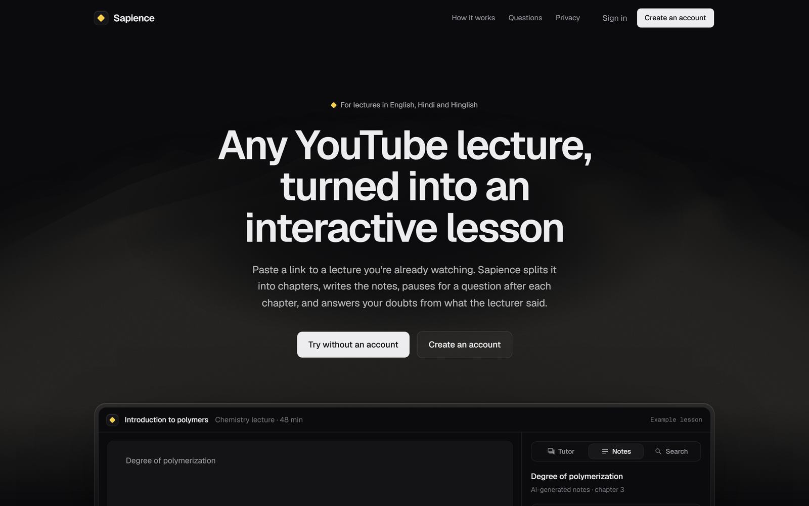
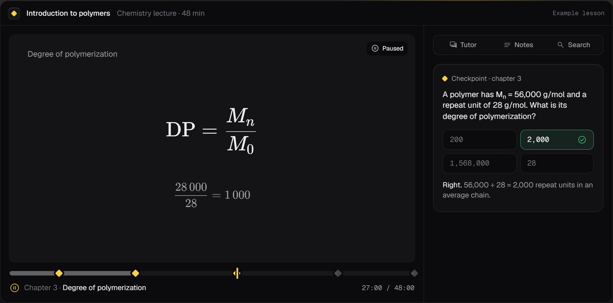
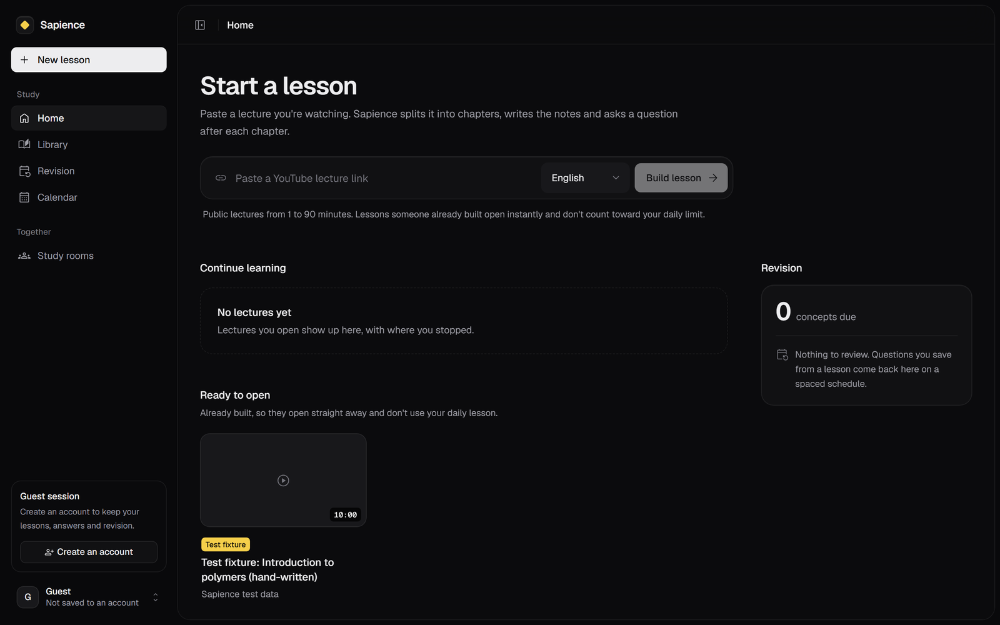
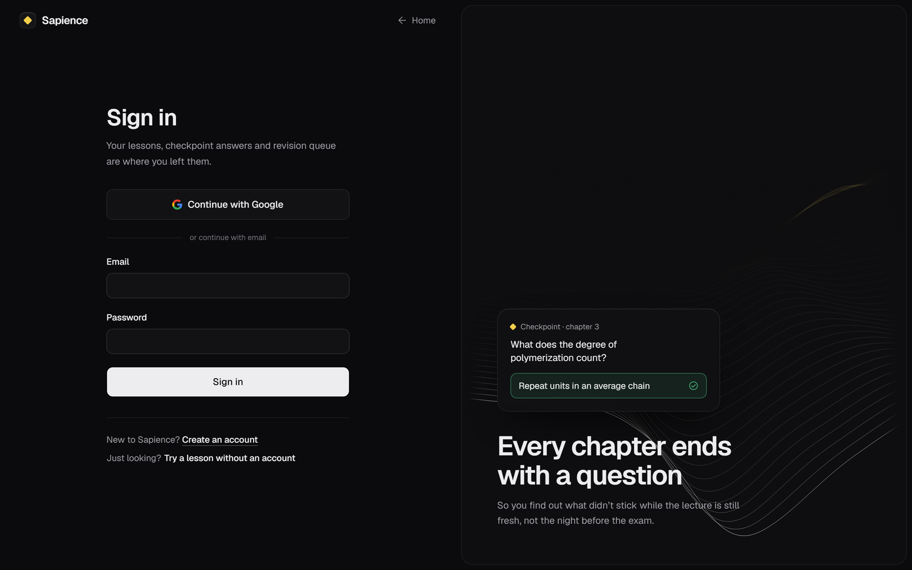
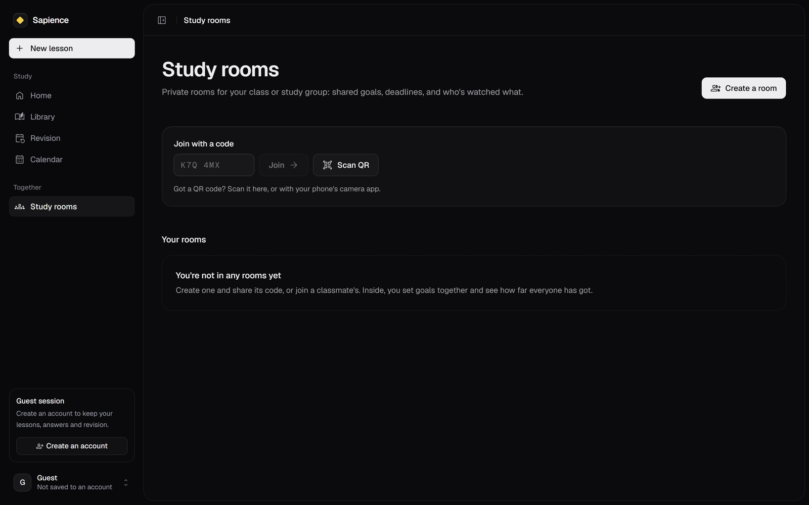
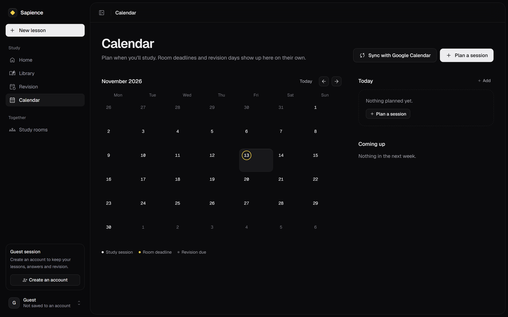

# Sapience

Any YouTube lecture, turned into an interactive lesson.

Paste a link to a lecture you're already watching. Sapience splits it into chapters, writes the notes, pauses for a question after each chapter, and answers your doubts from what the lecturer actually said. Works with lectures in English, Hindi and Hinglish.

Built by Team CodeCrushers for VentureX E-Summit '26 (PS3).



## What it does

- **Chapters and notes.** Every chapter gets a summary, key terms, formulas and timestamped key moments.
- **Checkpoints.** The video pauses at the end of each chapter for a question. Get it wrong and the tutor explains it another way.
- **Tutor.** Ask about the part you're watching. Answers come from the lecture, with timestamps you can jump to.
- **Practice.** Flashcards per chapter, and an adaptive quiz that gets harder when you're right and easier when you're not.
- **Weak spots.** Wrong answers, doubts and "mark as confusing" become time ranges you can rewatch back to back.
- **Revision.** Save any concept and it comes back on a spaced schedule (FSRS).
- **Study rooms.** Share a code or QR with your class, set goals, and see how far everyone got.
- **Calendar.** Plan study sessions and sync them to Google Calendar.

## Screenshots



<table>
  <tr>
    <td width="50%"><br><sub>Home: paste a lecture link to build a lesson</sub></td>
    <td width="50%"><br><sub>Sign in, or try it without an account</sub></td>
  </tr>
  <tr>
    <td><br><sub>Study rooms: join with a code or QR</sub></td>
    <td><br><sub>Study calendar with Google Calendar sync</sub></td>
  </tr>
</table>

## Stack

Next.js 16 (App Router), React 19, TypeScript, Tailwind CSS v4, shadcn/ui, Supabase (Postgres, Auth, RLS), Gemini through the AI SDK, Vitest and Playwright.

## Run it locally

You need Node 22+, pnpm and Docker (for the local Supabase stack).

```bash
pnpm install
cp .env.example .env.local
pnpm db:start        # local Supabase
pnpm db:reset        # apply migrations and seed data
pnpm dev             # http://localhost:3000
```

Fill in `.env.local` before `pnpm dev`. The server checks its environment at boot and won't start without:

| Variable | Where to get it |
|---|---|
| `NEXT_PUBLIC_SUPABASE_URL`, `NEXT_PUBLIC_SUPABASE_PUBLISHABLE_KEY`, `SUPABASE_SECRET_KEY` | `pnpm exec supabase status` |
| `GOOGLE_GENERATIVE_AI_API_KEY` | [Google AI Studio](https://aistudio.google.com/apikey) (free tier works) |
| `YOUTUBE_API_KEY` | Google Cloud, YouTube Data API v3 |
| `INTERNAL_JOB_SECRET` | `openssl rand -hex 32` |

Everything else in [`.env.example`](.env.example) is optional.

## Scripts

| Command | What it does |
|---|---|
| `pnpm dev` | Start the dev server |
| `pnpm typecheck` / `pnpm lint` | Types and ESLint |
| `pnpm test` | Unit tests |
| `pnpm test:rls` | Database, RLS and pipeline tests (local stack only) |
| `pnpm test:e2e` | Playwright end-to-end test (local stack only) |
| `pnpm db:types` | Regenerate `src/types/database.ts` from the schema |

## More

- [`docs/DEVELOPMENT.md`](docs/DEVELOPMENT.md): status, deployment setup (Supabase, Google OAuth, Vercel, Turnstile), design notes and per-phase details.
- [`SAPIENCE_IMPLEMENTATION_PLAN.md`](SAPIENCE_IMPLEMENTATION_PLAN.md): the full plan, and the source of truth.
